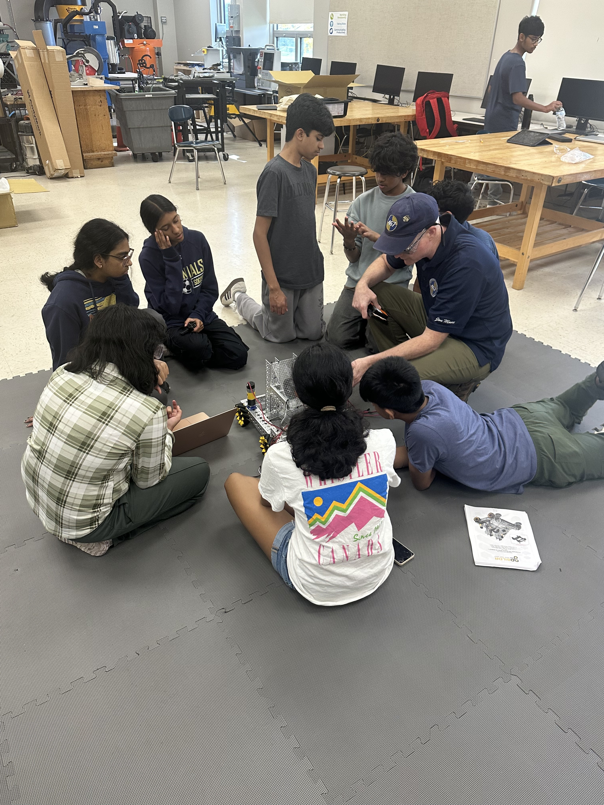



[**_FIRST_ Tech Challenge**](https://www.firstinspires.org/programs/ftc/) gives middle and high school students hands-on experience with engineering, programming, and teamwork. Students work with mentors to design, build, and program robots for an annual competition.

Teams develop their ideas, test their robots, and improve their designs as they prepare to compete together.





---

**Shrewsbury Robotics — Potential Energy**

Our FIRST Tech Challenge team, **37630: Potential Energy**, brings together 9th-grade students at Shrewsbury High School to build their engineering, programming, and teamwork skills.

* **Our team:** Team **37630**, **Potential Energy**, made up of 9th-grade Shrewsbury High School students.
* **Meetings:** Four times a week at **Shrewsbury High School**.

### _FIRST_ Tech Challenge

Students build and program a robot to complete the tasks in each season's game. Along the way, they practice problem-solving, collaboration, and communicating their engineering decisions.

#### Explore the competition

Visit the [official FIRST Tech Challenge website](https://www.firstinspires.org/programs/ftc/) to learn about the program and its competition!
