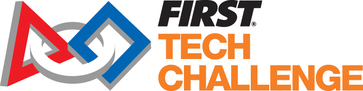

---



[**_FIRST_ Tech Challenge**](https://www.firstinspires.org/programs/ftc/) gives middle and high school students hands-on experience with engineering, programming, teamwork and community outreach.

Students work with mentors to design, build, and program robots for an annual competition.

Teams develop their ideas, test their robots, and improve their designs as they prepare to compete together.





---

### FTC at Shrewsbury Robotics

Shrewsbury Robotics offers _FIRST_ Tech Challenge for 9th-grade students at Shrewsbury High School, giving students an opportunity to build their engineering, programming, and teamwork skills.

Visit our [Fall Program]() page for details about our current team and season.
